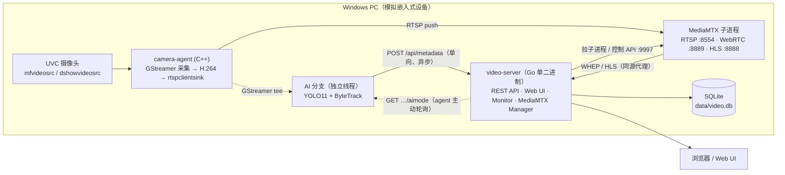

<div align="center">

# VisionFlow

**跨平台 AI 视频流处理与视觉检测平台**

从 UVC 摄像头到浏览器：采集 · 编码 · 推流 · 转发 · 播放 · 端侧 AI 检测 / 跟踪 · 结果回传

[](LICENSE)
[](#环境要求)
[](https://go.dev)
[](#环境要求)
[](#环境要求)
[](https://vuejs.org)
[](#环境要求)
[](https://github.com/bluenviron/mediamtx)

</div>

---

## 项目简介

VisionFlow 是一条**可端到端跑通的实时视频 + 端侧 AI** 链路。它把 Windows PC 上的 UVC 摄像头
（未来替换为 RK3568 等嵌入式 Linux 设备）当作"摄像头节点"，用一条 RTSP 推流链路把画面送进
媒体服务器，再由一个 Go 单二进制提供 REST API、嵌入式 Web UI 与 AI 结果落库，浏览器里就能
看到实时画面 + 检测框 + 17 点骨架。

| 子项目 | 语言 / 栈 | 角色 |
|---|---|---|
| [`video-server/`](video-server/) | Go 1.27 + Vue 3 | 服务端：MediaMTX 管理、REST API、Web UI、SQLite、AI 结果接收、AI 模式下发 |
| [`carmera-agent/`](carmera-agent/) | C++ / MSVC + GStreamer | 摄像头节点：采集 → H.264 编码 → RTSP 推流 → 端侧 AI → 结果上报 |
| [`docs/prompter/`](docs/prompter/) | Markdown | 分阶段任务提示词（step1–step3）与依赖安装清单 |

> **设计铁律**：AI 分支与 Metadata 分支**永远**不破坏视频链路。模型加载失败、推理异常、
> 服务端不可达、网络超时——视频照常 `STREAMING`，agent 绝不退出。

---

## 架构



**数据流要点**

- **媒体面**：`摄像头 → agent → MediaMTX → video-server → 浏览器`。播放优先 **WebRTC(WHEP)**，
  HLS 作为同源兜底（手机端用），由服务端 `/hls/<stream>/index.m3u8` 反向代理。
- **AI 面**：`tee → appsink → 独立线程 → ONNX Runtime`，与视频路径**完全隔离**；
  AI 关闭时管线字符串逐字节不变。
- **控制面**：`Web UI → POST /api/cameras/{id}/aimode → 落库`，agent 由**主动轮询**感知变化
  （agent→server 是单向 WinHTTP POST，没有反向推送通道）。
- **摄像头发现**：MediaMTX 的 `all_others.source: publisher` 让任意推流者自动建路径，
  monitor 每 3s 轮询控制 API `/v3/paths/list`，按 `stream_path` upsert 进 `cameras` 表。

---

## 仓库结构

```
VisionFlow/
├── video-server/                 # 服务端（Go + Vue3）
│   ├── cmd/video-server/main.go  # 入口：配置 → 开库 → 起 MediaMTX → 起 monitor → 起 HTTP
│   ├── internal/
│   │   ├── api/                  # REST 路由与处理器（含 aimode / metadata / hls 代理）
│   │   ├── camera/  database/    # 摄像头 Repository / SQLite 打开与建表
│   │   ├── config/  logger/      # YAML 配置（端口单一来源）/ 日志
│   │   ├── mediamtx/             # 生成临时配置、拉起子进程、健康探测、WHEP 代理
│   │   ├── metadata/             # AI 结果落库（ai_status / ai_frame / ai_object）
│   │   ├── monitor/  netiface/   # 3s 轮询自动发现 / 局域网地址枚举（物理网卡优先）
│   │   ├── dbutil/  server/  stream/
│   ├── web/                      # Vue3 前端源码（web/dist 由 //go:embed 打进二进制）
│   ├── config/                   # config.yaml / config.joint.yaml / mediamtx.yml
│   ├── scripts/                  # 构建、联合启停、firewall、verify_*.py 验收脚本
│   ├── build_onelick.bat         # 一键构建整个仓库（Web + server + agent）
│   └── start_oneclick.bat        # 一键启动服务端（自动清残留 → 等 /api/health → 打印地址）
│
├── carmera-agent/                # 摄像头节点（C++ / MSVC + GStreamer）
│   ├── include/camera_agent/     # 公共头：camera_manager / video_pipeline / rtsp_publisher
│   │   └── ai/                   #   detector / tracker / yolo_decode / ai_pipeline
│   ├── src/
│   │   ├── camera/ pipeline/ rtsp/   # 每层都有 _sim 与 _gst 两套实现（后端可插拔）
│   │   ├── ai/                   # yolo_detector.cpp(ORT) / byte_tracker.cpp / ai_pipeline.cpp
│   │   ├── metadata/             # encoder / manager / http_transport_winhttp.cpp
│   │   └── config/ common/       # 极简 YAML 解析 / StreamController 编排与自动重连
│   ├── models/                   # yolo11n.onnx（检测）、yolo11n-pose.onnx（17 关键点）
│   ├── tests/                    # 轻量测试框架，88 个用例（可无头运行）
│   ├── scripts/                  # build-msvc.ps1 / e2e-test.ps1 / probe-*.ps1 / mock server
│   └── build_oneclick.bat        # 一键构建（vcvarsall + VS 自带 CMake/Ninja）
│
├── docs/prompter/                # 各阶段任务提示词与依赖安装文档
└── LICENSE                       # MIT
```

> ⚠️ 目录名 `carmera-agent` 是本项目既有的历史拼写，代码与脚本中的路径均以它为准。

---

## 功能特性

### video-server（Go 单二进制）

- **单文件部署**：Vue3 前端经 `//go:embed all:dist` 打进同一个 `video-server.exe`，无需额外 Web 服务器。
- **MediaMTX 全托管**：按配置生成唯一临时 `data/mediamtx-*.yml` 并拉起/停止子进程，Ctrl+C 优雅退出并清理。
- **摄像头自动发现**：monitor 3s 轮询，无需手工登记；10s 无数据自动置 `offline`。
- **规格回填**：分辨率来自 MediaMTX `tracks2[].codecProps`；fps 由节流 ffprobe（每 120s 最多一次）
  探测；bitrate 由 `bytesReceived` 增量算出。三者均"0 不覆盖"，不会把已有数据清空。
- **局域网开箱可达**：`server.bind: 0.0.0.0` + `server.host: auto`，启动即打印本机与局域网全部可访问 URL。
- **播放链路加固**：WebRTC 优先、HLS 同源兜底、WHEP 端点启动竞态退避重试。
- **AI 结果落库**：三张表（`ai_status` / `ai_frame` / `ai_object`），滚动裁剪不拖慢写入。
- **服务端硬化**：不信任上游——bbox 反向修正 + 夹入画面 + 退化框撑开、confidence 夹取、
  超大包 decode 前即拒（413）、坏消息绝不覆盖好数据。

### carmera-agent（C++ / MSVC + GStreamer）

- **后端可插拔**：`CameraManager` / `VideoPipeline` / `RtspPublisher` 均为抽象接口，
  编译期选 `gstreamer` 或 `sim`（无 GStreamer 也能编译并跑完测试）。
  未来上 RK3568 只需新增 `camera_manager_v4l2.cpp`，接口与上层不动。
- **零外部依赖（视频侧）**：仅 `spdlog`（FetchContent 自动拉取）。
- **低延迟管线**：`queue max-size-buffers=2` 分段 + 编码器低延迟参数 + `rtspclientsink latency=0`，
  内部延迟探针实测约 20ms。
- **自动协商**：`--auto` 不加强制 caps，由设备协商原生格式，推流后回读真实规格并打印。
- **GOP 自适应**：拿到真实帧率后一次性重建管线，把 `keyint` 设为「≈1 秒的帧数」，
  解决"开流要等约 5s 才出首帧"（需注意 `nvh264enc` 的属性名是 `gop-size`，不是 `key-int-max`）。
- **码率自适应**：按协商出的宽×高×帧率估算（约 0.07 bit/像素，800–12000 kbps 区间）。
- **自动重连**：指数退避 `1/2/5/10s` 封顶，服务端恢复后自动回到 `STREAMING`。
- **端侧 AI**：YOLO11 检测 / 姿态 + ByteTrack；自写 letterbox、NMS、8 状态 Kalman，
  **不引入 OpenCV / Eigen**，只依赖 ONNX Runtime。
- **结果上报**：独立发送线程 + 有界队列（满则丢最老），服务端挂掉只记 WARN 并按退避重试。

---

## 技术栈

| 层 | 选型 |
|---|---|
| 服务端 | Go 1.27 · `modernc.org/sqlite`（纯 Go，无 CGO）· `gopkg.in/yaml.v3` |
| 前端 | Vue 3 · TypeScript · Vite 5 · Element Plus · WebRTC(WHEP) |
| 媒体 | MediaMTX v1.20.1（RTSP / WebRTC / HLS），由服务端作为子进程管理 |
| 采集 / 编码 | GStreamer 1.0（`mfvideosrc` / `dshowvideosrc` / `ksvideosrc`）· NVENC `nvh264enc` 或 `x264enc` |
| 端侧 AI | ONNX Runtime 1.x（CPU）· Ultralytics YOLO11n / YOLO11n-pose · ByteTrack |
| 构建 | MSVC v143 + Ninja（VS 自带 CMake）· `go build` · `npm run build` |

---

## 环境要求

| 工具 | 版本 / 说明 | 必需性 |
|---|---|---|
| Windows | 10 / 11 x64 | 必需 |
| Visual Studio 2022 | 含 "Desktop development with C++"（MSVC / Windows SDK / CMake / Ninja） | 必需（构建 agent） |
| GStreamer 1.0 | **MSVC 版** runtime + devel；运行时需把 `bin` 加入 `PATH` | 必需（真实采集） |
| Go | 1.27+ | 必需 |
| Node.js + npm | 任意较新 LTS | 必需（构建 Web UI） |
| MediaMTX | v1.20.1 二进制（**不随仓库分发**，需在配置里指明路径） | 必需 |
| ffmpeg / ffprobe | 含 libx264；验收脚本与播放验证依赖 | 必需 |
| ONNX Runtime | Windows x64 CPU，`include\` + `lib\` 即可（DLL 由 CMake 自动拷到 exe 旁） | 可选 |
| YOLO11 模型 | `yolo11n.onnx` / `yolo11n-pose.onnx`，放 `carmera-agent/models/` | 可选 |

> 缺少 ONNX Runtime → 编出 `NullDetector`，AI 自动停用；缺少模型 → 联合启动时 AI 默认关闭。
> 两者**都不影响视频链路**。依赖来源、版本、SHA-256 见 [`carmera-agent/third_lib.md`](carmera-agent/third_lib.md)
> 与 [`carmera-agent/ENV_SETUP.md`](carmera-agent/ENV_SETUP.md)。

---

## 快速开始

### 1. 克隆

```bash
git clone https://github.com/zc110747/VisionFlow.git
cd VisionFlow
```

### 2. 一键构建整个仓库

```bat
cd video-server
build_onelick.bat
```

五步自检：preflight（探测 go / node / VS）→ Web UI（`npm run build`）→ video-server（`go build`）
→ carmera-agent（调 `build_oneclick.bat`）→ summary（打印各产物字节数与下一步命令）。

```bat
build_onelick.bat --skip-web            :: 跳过 Web UI
build_onelick.bat --skip-agent          :: 跳过 camera-agent
build_onelick.bat --clean               :: 清空产物后重建
build_onelick.bat --backend sim         :: agent 后端：gstreamer(默认) | sim | auto
build_onelick.bat --no-pause            :: 无人值守（CI）
```

> 只想构建单个子项目：
> `cd video-server\web && npm install && npm run build` → `cd .. && go build -trimpath -o video-server.exe ./cmd/video-server`；
> `cd carmera-agent && build_oneclick.bat`（或 `.\scripts\build-msvc.ps1 [-Backend sim] [-Clean]`）。

> ⚠️ **`video-server/go.mod` 必须存在于工作区。** 它一度缺失，`go build` 会报
> `pattern ./...: directory prefix . does not contain main module`（或 `go.mod file not found`），
> 看起来像 Go 环境坏了，其实是仓库根本没有这个文件。根因是仓库根 `.gitignore` 里曾有一行
> `*.mod`（本意是 Fortran 模块文件），它同时匹配 Go 的 `go.mod`，于是 `git add` **静默跳过**、
> 文件从未被提交——`go.sum` 却提交了。现已在 `.gitignore` 中改为显式 `!go.mod` 例外并加注释。
> 判断某文件是否被忽略：`git check-ignore -v video-server/go.mod`（**有输出=被忽略**）。
> 若在旧分支上遇到该问题：`cd video-server && go mod tidy` 可依据 `go.sum` 重建 `go.mod`。

> ℹ️ **agent 的构建目录有两个名字，别搞混**：`scripts\build-msvc.ps1 -Backend gstreamer`
> 输出到 **`build-msvc-gst`**（`-Backend sim` 才用 `build-msvc`），而 `build_oneclick.bat`
> 输出到 `build-msvc`。根目录 `start.bat` 两个都会找，优先 `build-msvc-gst`。

### 3. 一键运行（推荐：联合运行）

```bat
cd video-server
scripts\start-joint.bat --ai --metadata
```

一条命令拉起 `video-server` + `camera-agent`，自动清残留、自动重建过期二进制、自动开浏览器。

```bat
scripts\start-joint.bat --no-browser
scripts\start-joint.bat --camera 0 --stream cam01
scripts\stop-joint.bat                      :: 停掉全部（含 MediaMTX 子进程）
```

| 环境变量 | 默认 | 说明 |
|---|---|---|
| `VS_CONFIG` | `config.joint.yaml` | 服务器配置文件名 |
| `CAMERA_ID` | 自动（`--list` 枚举后取第一个可用） | 摄像头索引 |
| `STREAM_ID` | `camera01` | RTSP 路径名 |
| `CAMERA_SOURCE` | 自动 | 强制 GStreamer 源（`mfvideosrc` / `dshowvideosrc` …） |
| `ENABLE_AI` | `0` | `1` = 给 agent 加 `--ai` |
| `ENABLE_METADATA` | `0` | `1` = 加 `--metadata`，把 AI 结果 POST 回服务端 |
| `NO_BROWSER` | `0` | `1` = 不开浏览器 |

> ⚠️ **联合运行时只有一个 MediaMTX。** `video-server` 自己拉起 MediaMTX 且只有它开启了控制 API
> （`:9997`，monitor 靠它发现摄像头）。**不要**在联合运行时执行 `carmera-agent\start-camera-agent.bat`
> —— 那会起第二个 MediaMTX 抢 `:8554`，而且没有控制 API，服务器根本看不到那路流。

### 4. 只跑服务端

```bat
cd video-server
start_oneclick.bat                          :: 默认 config\config.joint.yaml（:8081）
start_oneclick.bat --config config.yaml     :: :8080
start_oneclick.bat --no-browser --no-kill
```

用 `ffmpeg` 推一路合成流验证（无需摄像头）：

```bat
video-server\scripts\test-stream.bat camera01
```

### 5. 打开 Web UI

```
http://<本机或局域网 IP>:8081/     # 联合运行默认端口
```

启动时控制台会直接打印本机与局域网的全部可访问 URL，不必再 `ipconfig` 里猜。

---

## 配置

### video-server（`video-server/config/config.yaml`）

所有端口均在 YAML 配置，**源码中无硬编码端口**。

| 键 | 默认 | 说明 |
|---|---|---|
| `server.host` | `auto` | 对外 URL 的主机；`auto`/`0.0.0.0` = 自动取本机局域网 IPv4 |
| `server.bind` | `0.0.0.0` | HTTP 监听地址；`127.0.0.1` = 仅本机 |
| `server.http_port` | `8080` | REST API + Web UI（联合运行用 `8081`） |
| `rtsp.port` / `webrtc.port` | `8554` / `8889` | MediaMTX 对外端口 |
| `database.path` | `data/video.db` | SQLite 路径（目录自动创建） |
| `mediamtx.binary` | `mediamtx.exe` | MediaMTX 可执行文件（Windows 下缺 `.exe` 会自动补） |
| `mediamtx.config` | `./data/mediamtx.yml` | 运行时生成，不覆盖 `config/` 里的源文件 |
| `mediamtx.api_bind` / `api_port` | `127.0.0.1` / `9997` | 控制 API（仅本机，只供 monitor 轮询） |
| `mediamtx.hls_port` / `rtp_port` / `rtcp_port` | `8888` / `8000` / `8001` | 多实例并存时改 RTP/RTCP 避冲突 |
| `metadata.enabled` | `true` | `false` → `POST /api/metadata` 返回 503 + `Retry-After: 30` |
| `metadata.retention_rows` | `2000` | 每路保留的检测明细条数，`0` = 不裁剪 |
| `metadata.max_body_bytes` | `1048576` | 单包上限，超出 → 413 |
| `metadata.require_known_camera` | `false` | 联合运行**必须 `false`**（metadata 常早于 monitor 登记到达） |

### carmera-agent（`carmera-agent/config/camera-agent.yaml`）

优先级：**CLI 参数 > YAML 文件 > 内置默认值**。

```yaml
camera:   { id: 0, width: 1280, height: 720, fps: 30 }
encoder:  { codec: h264, bitrate: 4000, keyframe_interval: 30 }
stream:   { id: camera01 }
rtsp:     { server: 127.0.0.1, port: 8554 }

ai:
  enable: false                 # true: 人检测 + 跟踪
  fps: 8                        # 推理频率（可配范围 5–12）
  confidence: 0.5
  model: models/yolo11n.onnx    # 检测默认；yolo11n-pose.onnx 自动识别为姿态
  full_rate_below_fps: 10       # 源帧率低于此值 → 每帧都推理
  queue_size: 2                 # 有界队列，满则丢最老

metadata:
  enable: false
  server_url: http://127.0.0.1:8080/api/metadata
  queue_size: 8
  retry_interval_ms: 1000       # 首退避
  retry_max_interval_ms: 30000  # 退避上限
  heartbeat_interval_sec: 10    # 心跳周期；0 = 关闭
  insecure: false               # 仅 https 自签 DEV 服务器；生产环境禁用
```

常用命令行参数：

```bash
camera-agent --list                                    # 列出摄像头能力
camera-agent --auto --ai --metadata                    # 自动协商 + AI + 上报
camera-agent --width 1280 --height 720 --fps 60 --stream camera01 --bitrate 6000
camera-agent --latency-probe                           # 内部延迟探针
camera-agent --no-ai --metadata --metadata-heartbeat 0 # 只推流、不上报
```

> **建议始终带 `--auto`**：UVC 摄像头原生规格因机而异（本机上过 240×240@8fps，也上过 1280×720@30），
> 写死分辨率会导致 caps 协商失败、管线进不了 PLAYING、agent 陷入重连死循环。

---

## REST API

基址 `http://<host>:<http_port>`。

| 方法 & 路径 | 说明 |
|---|---|
| `GET /api/health` | `{"status","database","media_server"}` |
| `GET /api/net/addresses` | 监听地址 + 全部可访问 IP/URL（物理网卡优先） |
| `GET /api/cameras` | 摄像头列表（含 `rtsp_url`） |
| `POST /api/cameras` | 创建摄像头（`id` 必填） |
| `GET /api/cameras/{id}` | 详情 |
| `PUT /api/cameras/{id}` | 更新 |
| `DELETE /api/cameras/{id}` | 删除 |
| `GET /api/cameras/{id}/status` | 仅状态 `{"id","status"}` |
| `GET /api/cameras/{id}/stream` | 播放元数据（`rtsp_url`、分辨率、fps、bitrate、`webrtc.signaling`、`hls_url`） |
| `POST /api/cameras/{id}/webrtc` | 转发 SDP offer 到 MediaMTX WHEP，返回 answer |
| `GET /api/cameras/{id}/aimode` | 读取期望 AI 模式（默认 `ai-y`） |
| `POST /api/cameras/{id}/aimode` | 设置 AI 模式（`ai-off` / `ai-y` / `ai-y-pose`，非法值 400） |
| `POST /api/metadata` | 接收 agent 的 AI 结果（`frame` / `status`），成功一律 `204` |
| `GET /api/metadata` | 全局概览 `{"enabled","cameras":[{camera_id,frame,status}]}` |
| `GET /api/cameras/{id}/metadata` | 单路快照 |
| `GET /hls/{stream}/index.m3u8` | 同源 HLS 代理（手机端兜底播放） |

```bash
curl http://127.0.0.1:8081/api/cameras/camera01/metadata     # 单路 AI 快照
curl http://127.0.0.1:8081/api/metadata                      # 全局概览
curl -X POST http://127.0.0.1:8081/api/cameras/camera01/aimode \
     -H "Content-Type: application/json" -d '{"mode":"ai-y-pose"}'
```

---

## AI 能力

### 三模式运行时切换

控制链路：**Web UI → `POST /api/cameras/{id}/aimode` → 服务端落库 → agent 轮询 → 运行时换模型**（默认 `ai-y`）。

| 模式 | 含义 | agent 行为 | Web 行为 |
|---|---|---|---|
| `ai-off` | 关 AI 显示 | **不换模型**（保持启动模型），忽略请求 | 仅隐藏 overlay |
| `ai-y` | 人检测 | 运行时换 `yolo11n`（Detect） | 画检测框 |
| `ai-y-pose` | 姿态检测 | 运行时换 `yolo11n-pose`（Pose，17 关键点） | 画检测框 + COCO 骨架连线 |

切换在 AI 线程内完成：ONNX 重新加载（约数百 ms）在锁外进行，只有 `detector_` 指针交换加锁，
因此**绝不阻塞视频/采集线程**。

### 模型与实测性能

| 项 | 值 |
|---|---|
| 检测模型 | `yolo11n.onnx`（COCO，只用 class 0 = person），输入 640×640 letterbox |
| 姿态模型 | `yolo11n-pose.onnx`（17 COCO 关键点，`[x, y, conf]`，坐标已裁剪入帧） |
| 推理耗时（i7-8700，CPU） | 检测 ≈ 88 ms / 帧；姿态 ≈ 112–150 ms / 帧 |
| AI 循环 | 默认 8 fps（可配 5–12）；源帧率 < 10 时每帧都跑；帧间丢最老保最新 |
| 跟踪 | ByteTrack（8 状态 Kalman + 二阶段关联），纯 C++，RK3568 可复用 |
| 视频侧影响 | 1280×720@30 开 AI 时 17s / 511 帧 ≈ 30fps，**0 dropped** |

### 阶段验证记录（真实设备）

| 场景 | 摄像头 | 结果 |
|---|---|---|
| 1280×720@30，关 AI | LRCP USB2.0 | `STREAMING`，~4 Mbps，管线串不含 `aisplit/aisink/aiconv/aiq` |
| 1280×720@30，开 AI | LRCP USB2.0 | 视频 30fps 0 dropped；AI 5.0 fps / infer ≈ 90 ms / track ≈ 0.01 ms |
| 同上，画面有人 | LRCP USB2.0 | 20s 内 `id=1 person` 稳定（conf 0.74–0.91），frame_id 间隔 ≈ 6，PTS 单调 |
| `bus.jpg` 端到端 | 静态图 | 检测 4 个 person；姿态 4 人 × 17 关键点全部落在帧内 |

---

## AI Metadata 协议

agent → server 的**单向异步**通道，与视频流互不阻塞。一个端点 `POST /api/metadata`，由 `type` 区分。

```jsonc
// frame —— 一次推理结果（默认 5/s），落 ai_frame + ai_object
{"version":1,"type":"frame","camera_id":"camera01","frame_id":15230,"timestamp":1756773210123,
 "video_width":1280,"video_height":720,
 "objects":[{"class":"person","confidence":0.93,"track_id":17,"bbox":[812,210,1040,850],
             "keypoints":[[512.3,214.6,0.97], "... 共 17 项（仅 pose 模型输出）"]}]}

// status —— AI 存活心跳 + 模型身份（默认 10s），落 ai_status
{"version":1,"type":"status","camera_id":"camera01","wall_clock":1756773215000,
 "ai":{"enable":true,"running":true,"fps":5.00,"model":"models/yolo11n.onnx",
       "tracker":"bytetrack","last_frame_id":15230,"last_timestamp":1756773210123,"processed":99}}
```

**关键约束**

| 约束 | 落地方式 |
|---|---|
| `frame_id` / `timestamp` 由**采集侧**产生 | 编码器原样拷贝（摄像头帧计数 / `GST_BUFFER_PTS`），服务端**原样存储，绝不重编号** |
| `bbox` 用原始视频像素 `[x1,y1,x2,y2]` | 发送端 `clampi()` 裁剪 + 退化框撑开成 1×1；服务端**再夹一次**（不信任上游） |
| 每条消息必须带 `type` 与 `version` | 单测断言锁死；缺 `type` 会被服务端当畸形消息拒收 |
| **空结果也要发** | `objects: []` 照常编码，服务端据此判断 AI 存活 |
| agent 侧绝不阻塞 | `push_result()` 只做 JSON 编码 + 短锁入队；发送线程独占全部阻塞工作 |
| 落库粒度 | `ai_status` / `ai_frame` 每路一行（最新），`ai_object` 明细按 `retention_rows` 滚动裁剪（每 64 次保存批量裁一次） |

---

## 验证与测试

### 单元测试

```bash
# carmera-agent：88 个用例（GStreamer 构建在 build-msvc-gst；ORT / 真帧集缺失时 AI 用例自动 skip）
cd carmera-agent && ctest --test-dir build-msvc-gst --output-on-failure

# video-server：91 个断言（62 个顶层用例 + 29 个子测试）
cd video-server && go test ./...
```

覆盖：摄像头枚举 / 管线创建 / H264 编码 / RTSP 连接断开 / 自动重连退避封顶 / 参数错误 /
AI 端到端（真图检出 + ByteTrack 稳定 ID + 生命周期）/ YOLO11 双布局解码与 pose 关键点逆变换 /
运行时 AI 模式切换 / Metadata JSON 字段与 bbox 裁剪、空结果、心跳、有界队列、断服不阻塞、
恢复后重连计数；以及 Go 侧的 aimode 校验、HLS 代理、SQLite 并发、MediaMTX 管理器与重试。

### 端到端验收（脚本统一输出 `PASS/FAIL` 计数，失败非零退出）

```bash
cd video-server
python scripts/verify_joint.py          # 真实推流端（C++ agent + GStreamer）整条链路，PASS=19 FAIL=0
python scripts/verify_joint.py --keep   # 结束时不杀进程，便于人工查看
python scripts/verify_e2e.py            # ffmpeg 合成流，多路并发
python scripts/verify_metadata.py       # AI metadata 接收（含旧版无 type 兼容）
python scripts/verify_metadata_https.py # HTTPS 上报路径
python scripts/verify_ai_resilience.py  # AI 韧性：服务端挂掉 / 模型缺失 / 模式切换
python scripts/verify_keypoints_aimode.py # keypoints 透传 + AI 模式联动

# carmera-agent 侧：真实 GStreamer 后端四阶段验收（拉帧 → 断服 → 退避 → 自动恢复）
cd carmera-agent && .\scripts\e2e-test.ps1
```

`verify_joint.py` 断言的检查项（stage 1→6b）：agent 枚举到摄像头 → 服务三态健康
（`database` / `media_server` / `status` 全 `ok`）→ agent 进入 `STREAMING` → 流被 monitor
自动注册并置 `online` → `ffprobe` 在 RTSP 上真解出 `h264` → 协商分辨率 / fps / bitrate
经 MediaMTX 传到 API 且与实测一致 → AI metadata 心跳与 frame 到达服务端、`object_count`
与 payload 一致、bbox 落在画面内。

> stage 7（WHEP 信令）是**信息项，不计入 PASS/FAIL**：脚本发的是手工拼的 SDP，缺少
> `ice-ufrag` / `fingerprint`，无法完成 ICE/DTLS 协商；服务端对任何 WHEP 信令失败统一返回
> `502 Bad Gateway`（`internal/api/handlers.go`）。要验证完整播放路径请用真实浏览器打开 Web UI。

---

## 端口表

| 端口 | 进程 | 用途 |
|---|---|---|
| `8080` / `8081` | video-server | REST API + 嵌入式 Web UI（联合运行默认 `8081`，避开 `8080` 冲突） |
| `8554` | MediaMTX（video-server 子进程） | RTSP：agent 推入、播放器拉出 |
| `9997` | MediaMTX | 控制 API，仅本机，monitor 每 3s 轮询 |
| `8889` | MediaMTX | WebRTC（WHEP 由服务端代理），含 UDP + TCP ICE 监听 |
| `8888` | MediaMTX | HLS（由服务端在 `/hls/*` 同源代理） |
| `8000` / `8001` | MediaMTX | RTP / RTCP UDP |

> 首次运行需放行防火墙：
> `video-server\scripts\firewall-add.bat`（移除用 `firewall-remove.bat`）。

---

## 已知限制

- **平台**：真实采集后端目前只在 Windows 上验证（`mfvideosrc` / `dshowvideosrc` / `ksvideosrc`）。
  Linux / RK3568 需要新增 V4L2 后端实现（接口已抽象好）。
- **推理后端**：仅 CPU（`onnxruntime`）。1080p 输入下推理时间不变（letterbox 到 640×640），
  但 RGB 帧拷进 AI 线程的开销随分辨率线性增长（720p ≈ 80 MB/s，可忽略）。
- **Metadata 传输**：当前实现是 WinHTTP，仅 Windows；非 Windows 目标编译期落到
  `NullMetadataTransport`，需补一个 curl 实现才能启用。
- **无反向推送通道**：服务端到 agent 只有 agent 主动轮询，AI 模式切换有最多一个轮询周期的延迟。
- **HLS 时延**：HLS 仅作手机端兜底，实时性不如 WebRTC（服务端保留主要是为后续录播回放）。
- **fps / bitrate 为推断值**：MediaMTX 控制 API 不暴露帧率，fps 靠节流 ffprobe 探测、
  bitrate 靠累计字节增量推算，UI 上短暂为空属正常过渡态。

## Roadmap

- [ ] V4L2 采集后端（RK3568 真机）
- [ ] ONNX Runtime → RKNN 推理后端（`IDetector` / `ITracker` 抽象已就绪）
- [ ] curl 版 metadata transport（脱离 Windows）
- [ ] 目标类别扩展（当前只消费 COCO class 0 = person）
- [ ] 检测历史回放（HLS 录播链路已保留）

## 许可

[MIT](LICENSE) © 2026 听心跳的声音
